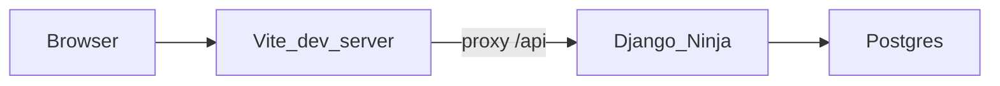

# Architecture

Django is an API only. The React app is the UI. Compose runs Postgres, Django, and the Vite dev server. The browser talks to Vite. Vite proxies `/api` to Django, so the client does not hard-code a backend host.

## Request path

1. The browser loads the Vite app at `http://localhost:5173`.
2. UI code calls same-origin paths such as `/api/health` through `frontend/src/api/client.ts`.
3. Vite proxies `/api` to Django (`http://backend:8000` on the Compose network).
4. Django Ninja serves the API object defined in `backend/config/api.py`, mounted at `/api/` from `backend/config/urls.py`.
5. Django uses Postgres via `DATABASE_URL`.

`GET /api/health` is the only product route. It checks that Postgres accepts a connection and returns `{"status": "ok"}`. That route is how we prove Compose, migrations, and the proxy. Ninja's generated schema under `/api/docs` is a development aid, not a product screen.

## Settings

`backend/config/settings/base.py` holds shared configuration and reads hosts, the secret key, the database URL, and CORS origins from the environment. `local.py` is what `manage.py` and Compose use. `test.py` is what pytest uses. Nothing in settings hard-codes a secret or a database URL.

## Where code goes

| Concern | Location |
| --- | --- |
| Process, settings, URL mounting | `backend/config/` |
| One HTTP route group | `backend/apps/<name>/api.py` and `schemas.py` |
| HTTP from the browser | `frontend/src/api/` |
| Screens for one context | `frontend/src/features/<name>/` |

## Future bounded contexts

These stay documented until a task asks for them. Creating the packages early invites invented models.

| Context | Backend app | Frontend feature | Responsibility |
| --- | --- | --- | --- |
| Patients | `backend/apps/patients/` | `frontend/src/features/patients/` | Patient records |
| Notes | `backend/apps/notes/` | `frontend/src/features/notes/` | Clinical notes |
| Scheduling | `backend/apps/scheduling/` | `frontend/src/features/scheduling/` | Appointments |
| Therapist accounts | `backend/apps/accounts/` | `frontend/src/features/accounts/` | Therapist identity and access |

When one of these is added, register its Ninja router from `backend/config/api.py`. Keep product UI in React.

## Runtime

`docker-compose.yml` starts three services:

- `db` — Postgres 16. Data is the Compose volume `postgres_data`.
- `backend` — Python 3.12 image. On start it waits for Postgres, runs migrations, and serves Django on port 8000.
- `frontend` — Node image. Runs the Vite dev server on port 5173 and proxies `/api` to `backend`.

Environment variables are listed in `.env.example`. The real `.env` stays untracked.
